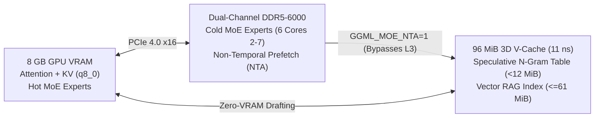

# zen-vcache-ai: Practical 3D V-Cache Acceleration for Local AI

[](LICENSE)
[-orange.svg)](#architecture--memory-split)
[](#real-world-results)

## TL;DR

If you run local LLMs on an **8 GB VRAM GPU** paired with an **AMD Ryzen X3D CPU (96 MiB L3)**, large models spill into system RAM and feel sluggish. **zen-vcache-ai** is a collection of reproducible benchmarks, CPU/memory wrappers (`vcache-run`), AVX-512 kernels, and `llama.cpp` tuning recipes that push **35B MoE models to 76.3 tok/s**, accelerate **GPU code editing by 1.2x–10.8x** with zero extra VRAM, and run **1M-vector RAG inside L3 in 163 µs**.

> [!IMPORTANT]
> **Do not throw all 8 cores at DDR5-spilling MoE experts.** On a single-CCD 7800X3D, dual-channel DDR5-6000 saturates before 8 cores. Pinning inference to **6 cores (`2-7`)** via `vcache-run` leaves cores `0-1` for your desktop/OS and beats 8-core runs in both throughput (`+6.2%` to `+9.3%` over 4C) and tail jitter.

> [!TIP]
> **Core pinning alone does not partition the 96 MiB L3.** Consumer Ryzen CPUs have no hardware PQoS/CAT cache partitioning, so background streaming writes on cores `4-7` still evict L3 lines used by cores `0-3`. Using non-temporal hints (`_MM_HINT_NTA` / `_mm_stream_si64`, `GGML_MOE_NTA=1`) prevents L3 pollution and boosts `Qwen3.8-35B-A3B` prompt processing by **`+22.2%`**.

## Architecture & Memory Split



## Real-World Results

Measured on **AMD Ryzen 7 7800X3D (96 MiB L3, `SMT=Off`, `THP=always`) + NVIDIA RTX 3070 8 GB** on Arch Linux:

| Workload | Setup | Result | What It Means in Practice |
| :--- | :--- | :--- | :--- |
| **35B MoE (`Qwen3.8-35B-A3B`)** | `vcache-run -c 2-7` + `--moe-cache-mib 4608` + `GGML_MOE_NTA=1` | **`76.3 tok/s`** (`+25.5%` gen, `+22.2%` pp128) | Smooth 35B MoE on 8 GB VRAM while desktop stays responsive |
| **26B MoE (`Gemma 4 26B.A4B`)** | `6C (2-7)` + `--moe-cache-mib 3072` + `q8_0 KV` | **`40.5 tok/s`**, **50% less KV VRAM** | Fits `c=8192` context with ~0% speed penalty vs FP16 KV |
| **Code Editing (`Qwen3.5-9B`)** | `--spec-type ngram-map-k4v,ngram-mod` (`0 MiB` extra VRAM) | **`80.9 tok/s`** (`1.19x` refactor) up to **`701.9 tok/s`** (`10.80x` warm) | Faster code generation and refactoring for free |
| **Local Vector RAG (1M vectors)** | 8-thread AVX-512 `VPOPCNTDQ` (`61 MiB` in L3) | **`162.8 µs`** (**`6,144 QPS`**, `366 GB/s`) | Sub-millisecond retrieval with zero GPU usage |
| **10M-Vector RAG (`512-d`)** | Two-tier L3 RaBitQ (`36.5 MiB`) + THP `VPDPBUSD` (`4.84 GiB` DDR5-NTA) | **`296.4 µs`** P50 / **`358.0 µs`** P99 (**`3,313 QPS`**, `0.938` Recall@10) | Scales 10× past L3 capacity with `0` GPU VRAM |
| **Contention Isolation (`NTA`)** | `_mm_stream_si64` background thrashers vs L3 index | **`2,596.2 µs` P99** (`83.5 µs` std vs `151.0 µs` unpinned) | Prevents background tasks from spiking RAG/draft latency |

### Why These Numbers Matter

- **Why `76.3 tok/s` on a 35B MoE (`8 GB` VRAM) is unusual:** A `35B Q4` model is ~`20 GB`, so over `12 GB` spills into system RAM. Dual-channel DDR5-6000 typically yields ~`65–75 GB/s` under load, and naive `llama.cpp` CPU+GPU spillover usually sits around `30–50 tok/s` with desktop stutter. Keeping attention, KV cache, and hot experts in `8 GB` VRAM while streaming only the ~`3B` active parameters per token with `vcache-run -c 2-7` and `GGML_MOE_NTA=1` prevents L3 cache thrashing and keeps generation faster than reading speed.
- **Why `162.8 µs` (`6,144 QPS`, `366 GB/s`) for 1M-vector RAG is 10–50× faster than RAM search:** Standard RAM-bound vector search (FAISS/HNSW over DDR5) takes **1–10 ms**. Packing 1M binary vectors into `61 MiB` fits the entire index inside the `96 MiB` 3D V-Cache, where 8-thread AVX-512 `VPOPCNTDQ` computes Hamming distances at `366 GB/s` L3 bandwidth with **0% GPU usage**—ideal as an instant stage-1 retriever before reranking.

### When 3D V-Cache Helps vs. When It Does Not

- **Huge win (2x–5x):** Working sets between **32 MiB and 96 MiB** (HNSW/PQ64 vector RAG, `SQLite` mmap databases, small classifiers) and keeping `< 12 MiB` speculative n-gram tables hot under desktop load.
- **No magic bullet:** Dense or MoE model weights **> 96 MiB** streaming from system RAM (e.g., even a `463 MiB` `0.5B Q4_K_M` model on CPU) are bottlenecked by **DDR5 bandwidth**, not L3 size. Fully VRAM-resident GPU models do not touch CPU L3 during forward passes.

### Single-CCD vs. Dual-CCD X3D & Non-X3D CPUs

- **Single-CCD X3D (`7800X3D`, `9800X3D`):** All 8 cores share the single `96 MiB` L3. Pinning inference to `6` cores (`vcache-run -c 2-7`) reserves cores `0-1` for the desktop/compositor while still saturating dual-channel DDR5, and `GGML_MOE_NTA=1` keeps cold MoE streaming from polluting L3.
- **Dual-CCD X3D (`7900X3D`, `7950X3D`, `9950X3D`):** Only **CCD0** has the `96 MiB` 3D V-Cache (CCD1 has `32 MiB` L3). Pinning inference strictly to CCD0 (`vcache-run -c 2-7` or `0-7` while leaving OS/background tasks on CCD1) avoids cross-CCD Infinity Fabric penalties and provides **even cleaner L3 isolation** than single-CCD chips. Do not span cold MoE spillover across both CCDs—desktop Ryzen still shares a single dual-channel DDR5 controller.
- **Non-X3D CPUs (`32 MiB` L3):** A `61 MiB` 1M-vector index will not fit in L3 and falls back to DDR5 speeds, though `GGML_MOE_NTA=1` and channel-aware thread pinning still help prevent L3 thrashing and DDR5 saturation.

## Quickstart

```bash
# 1. Build AVX-512 + Zen 4 PMU shared libraries
make -C kernels

# 2. Run unit tests & inspect your CPU L3/AVX-512 topology
PYTHONPATH=src python3 -m unittest discover -s tests -p "test_*.py" -v
PYTHONPATH=src python3 -m vcache.topology

# 3. (Optional) Apply GGML_MOE_NTA=1 & MADV_HUGEPAGE patches to your llama.cpp checkout
git -C /path/to/llama.cpp apply "$(pwd)/patches/ggml-moe-nta.patch"
git -C /path/to/llama.cpp apply "$(pwd)/patches/ggml-mmap-thp.patch"

# 4. Run hybrid MoE or 10M RAG pinned to 6 cores (2-7) with jemalloc + THP
GGML_MOE_NTA=1 ./bin/vcache-run --profile rag -- llama-server -m model.gguf -ngl 99 -cmoe --moe-cache-mib 4096 -t 6
./bin/vcache-run --profile rag -- python3 benchmarks/bench_l3_rabitq_10m.py --full-10m --json-out results/l3_rabitq_10m.json

# 5. Reproduce the full C/Python benchmark suite (with pre-flight, Zen 4 PMU, and E2E)
./reproduce.sh --perf --full
```

## Detailed Benchmarks & Methodology

<details>
<summary><strong>1. Hybrid MoE Core Scaling, VRAM Expert Cache &amp; KV Quantization</strong></summary>

Measured via `llama-bench -ngl 99 -ot "\.ffn_.*_exps\.=CPU" -p 128 -n 64 -r 3` under `vcache-run`:

| Model | `4C (4-7)` `tg64` | `6C (2-7)` `tg64` | `7C (1-7)` `tg64` | `8C (0-7)` `tg64` | Optimal (`6C` vs `4C`) |
| :--- | :---: | :---: | :---: | :---: | :---: |
| **Gemma 4 26B.A4B MXFP4 MoE** (`15.40 GiB`) | `38.18 ± 0.23 t/s` | **`40.54 ± 0.21 t/s`** | `38.69 ± 1.26 t/s` | `37.11 ± 1.33 t/s` | **+6.2%** (`pp128`: **+9.2%**) |
| **Qwen 3.8 35B.A3B Q3_K_M** (`16.44 GiB`) | `59.45 ± 0.73 t/s` | **`64.97 ± 0.76 t/s`** | `63.14 ± 1.80 t/s` | `62.77 ± 2.92 t/s` | **+9.3%** (`pp128`: **+4.5%**) |

**VRAM Hot-Expert Cache (`--moe-cache-mib`) on 8 GB RTX 3070 (`6C 2-7`):**

| Model | `-ot` (All Experts CPU) | `--moe-cache-mib 2048` | `--moe-cache-mib 3072` | `--moe-cache-mib 4096` | `--moe-cache-mib 4608` |
| :--- | :---: | :---: | :---: | :---: | :---: |
| **Gemma 4 26B.A4B** (`c=8192, q8_0`) | `35.5 t/s` | `31.4 t/s` | **`40.1 t/s`** (+13.0%) | OOM | OOM |
| **Qwen 3.8 35B.A3B** (`c=4096`) | `60.8 t/s` | `55.5 t/s` | `63.1 t/s` | **`72.4 t/s`** (+19.1%) | **`76.3 t/s`** (+25.5%) |

**Long-Context (`pp4096`) KV Cache Quantization (`Gemma 4 26B.A4B`, `6C`):**

| KV Cache (`K / V`) | `pp4096` | `tg64` | Notes |
| :--- | :---: | :---: | :--- |
| `f16 / f16` | `825.89 t/s` | `40.51 t/s` | Baseline precision |
| **`q8_0 / q8_0`** | **`822.81 t/s`** | **`40.43 t/s`** | **~0% speed penalty, 50% KV VRAM** |
| `q4_0 / q4_0` | `798.59 t/s` | `40.21 t/s` | -3.3% prefill dequant overhead |

</details>

<details>
<summary><strong>2. Zen 4 PMU Verification, Cache Cliff &amp; NTA Contention Guard</strong></summary>

- **Cache Cliff (`cache_cliff`, 2MB THP):** Latency stays flat at **10.45–11.25 ns** (`8–64 MiB`), rises to **`20.42 ± 0.59 ns`** at `96 MiB`, and spills to DDR5 at **`31.62–56.52 ns`** (`112–256 MiB`).
- **Zen 4 Hardware PMU (`perf stat`, 0% multiplexing):** `ls_dmnd_fills_from_sys.local_ccx = 2,312,927,028` (L3 CCX hits) vs `ls_dmnd_fills_from_sys.dram_io_near = 697,828,326` (DDR5 fills).
- **L3 Thrasher Sensitivity (Cores `0-1`, 64 MiB thrasher):**
  - `16 MiB` buffer (`LsDmndFillsFromSys`): `0.05%` → `57.05%` miss rate (`1,141x` jump)
  - `500k` vector scan (`30.52 MiB`, 8T AVX-512): `80.86 µs` → `4,010.78 µs` (`49.6x` slower)
  - GPU N-Gram Speculative (`MiMo 9B`): `80.7` → `78.4 tok/s` (`-2.8%`)
- **Non-Temporal Guard (`contention_benchmark.py`, 1614-doc L3 index):**
  - Quiet (`0-3`): `P50 = 2,217.1 µs`, `P99 = 2,435.8 µs`, `STD = 69.3 µs`
  - Unpinned (`0-7`) under 4x 128 MB temporal thrashing: `P99 = 2,968.3 µs`, `STD = 151.0 µs`
  - Pinned (`0-3`) vs Temporal thrashers (`4-7`): `P99 = 2,772.7 µs`, `STD = 116.9 µs`
  - Pinned (`0-3`) vs NTA (`_mm_stream_si64`) thrashers (`4-7`): `P99 = 2,596.2 µs` (`-176.5 µs`), `STD = 83.5 µs`

</details>

<details>
<summary><strong>3. Speculative Decoding &amp; On-Policy SpecOPD Micro-Drafts (d64 / d128 / d192)</strong></summary>

**N-Gram Speculative Attribution (`Qwen3-4B Q4_K_M`, `--reasoning-budget 0`):**
- Code Refactoring: `121.8 tok/s` → **`127.3 tok/s`** (`ngram-mod`, 0 MiB VRAM) vs `43.4 tok/s` (untrained `12M` CPU draft).
- Greenfield Rust: `119.7 tok/s` → **`120.6 tok/s`**.

**Standalone Micro-Draft Roofline (`llama-bench`, `vcache-run -c 2-7 -n 128 -r 3`):**

| Micro-Draft | Params / File (`L3` Payload) | CPU 6C (`-ngl 0`) `tg128` | GPU RTX 3070 (`-ngl 99`) `tg128` | Winner |
| :--- | :---: | :---: | :---: | :--- |
| **`d64` (`L=4, d=64`)** | `10.02 M` / `15.81 MiB` | **`5,042.37 ± 29.03 tok/s`** (`0.20 ms/tok`) | `3,234.52 ± 94.03 tok/s` | **CPU 3D V-Cache (+55.9%)** |
| **`d128` (`L=4, d=128`)** | `20.63 M` / `26.56 MiB` | **`4,140.33 ± 85.54 tok/s`** (`0.24 ms/tok`) | `3,466.42 ± 44.81 tok/s` | **CPU 3D V-Cache (+19.4%)** |
| **`d192` (`L=4, d=192`)** | `31.53 M` / `37.61 MiB` (`31.96 MiB` tensors) | **`3,217.65 ± 44.41 tok/s`** (`0.31 ms/tok`) | `3,102.41 ± 67.06 tok/s` | **CPU 3D V-Cache (+3.7%)** |

**On-Policy SpecOPD Out-of-Sample `llama-speculative` (`n_max=4`, `n=96`):**

| Model / Mode | Stage 1 `top1_acc` | Stage 2 `prefix_accept` | Refactor (`accept` / `tok/s`) | Chat Rust (`accept` / `tok/s`) | Greenfield (`accept` / `tok/s`) |
| :--- | :---: | :---: | :---: | :---: | :---: |
| **Baseline `Qwen3-4B Q4_K_M` (GPU)** | — | — | `—` / **`120.2–122.0 tok/s`** | `—` / **`120.2–121.8 tok/s`** | `—` / **`120.2–121.4 tok/s`** |
| **Trained `d128` -> `Qwen3-4B` (`ngld=99`)** | `96.53%` | `89.32%` | `13.10%` / `101.2 tok/s` | `5.77%` / `80.3 tok/s` | `3.57%` / `76.4 tok/s` |
| **Trained `d192` -> `Qwen3-4B` (`ngld=0`)** | `96.34%` | `94.01%` | **`18.64%`** / **`110.8 tok/s`** | **`13.10%`** / **`96.6 tok/s`** | **`3.92%`** / `73.7 tok/s` |
| **Baseline `DeepSeek-R1-0528-Qwen3-8B` (GPU)** | — | — | `—` / **`76.0 tok/s`** | `—` / **`76.0 tok/s`** | `—` / **`76.0 tok/s`** |
| **Trained `d192` -> `DeepSeek-R1-8B` (`ngld=99`)** | `92.32%` | `85.42%` | **`13.10%`** / `62.8 tok/s` | `9.03%` / `55.9 tok/s` | **`4.57%`** / `48.9 tok/s` |

*Note: Micro-drafts fit in L3 and run faster on CPU than GPU, but `59k–79k` rollout tokens remain below the ~45–60% acceptance breakeven needed to beat a fast GPU baseline without multi-million-token distillation or EAGLE-style hidden-state reuse. Top-16K `lm_head` shortlist pruning (`benchmarks/bench_shortlist_16k.py`, `results/shortlist_16k_r1_8b.json`) shrinks `d192` `lm_head` from `29.56 MiB` to `3.19 MiB` and accelerates CPU drafting `4.97×` (`142.3 -> 707.3 tok/s`) with negligible acceptance loss (`0.1105 -> 0.1087`), confirming `prefix_accept` remains the primary bottleneck.*

</details>

<details>
<summary><strong>4. Repository Layout</strong></summary>

```text
zen-vcache-ai/
├── bin/               # vcache-run, vcache-spec-bench, vcache-distill-specopd, vcache-train-specopd
├── src/vcache/        # topology, AVX-512 vector ctypes, SpecOPD trainer & GGUF exporter
├── kernels/           # OpenMP AVX-512 VPOPCNTDQ/VPDPBUSD/INT8 & Zen 4 PMU C kernels
├── benchmarks/        # Standalone C/Python L3, 10M RaBitQ+VNNI & DDR5 microbenchmarks
├── patches/           # ggml-moe-nta.patch (_MM_HINT_NTA), ggml-mmap-thp.patch (MADV_HUGEPAGE)
├── examples/          # Lockless /dev/shm IPC & Zstd L2/L3 stream examples
├── results/           # Saved raw outputs & Zen 4 PMU stats
├── tests/             # Unit tests (topology, vector, specopd, benchmark)
└── reproduce.sh       # Automated reproduction script (--perf, --full)
```

</details>

---

## Acknowledgments

This project builds on the work of the following open-source projects and maintainers:

- **[llama.cpp](https://github.com/ggml-org/llama.cpp)** & **[ggml](https://github.com/ggml-org/ggml)** (Georgi Gerganov & contributors) — Local LLM inference engine, MoE `mul_mat_id`, and `q8_0` KV cache support.
- **[ik_llama.cpp](https://github.com/ikawrakow/ik_llama.cpp)** (Iwan Kawrakow) — Hybrid CPU/GPU MoE optimization techniques and benchmark documentation structure.
- **[jemalloc](https://github.com/jemalloc/jemalloc)** & **[numactl](https://github.com/numactl/numactl)** — Memory allocator and CPU/NUMA pinning primitives used by `vcache-run`.
- **[zstd](https://github.com/facebook/zstd)** & **[SQLite](https://www.sqlite.org/)** — Dictionary compression and memory-mapped database engines benchmarked in L2/L3 studies.

---

## Support / Hardware Fund

If these L3 3D V-Cache benchmarks, Zen 4 PMU measurements, or `llama.cpp` `_MM_HINT_NTA` patches saved you time, you can support future hardware-level research (**target: RTX 3090 24 GB & Zen 5 X3D benchmarks**):

- **Ko-fi (0% platform fee):** [`ko-fi.com/simonezpx3`](https://ko-fi.com/simonezpx3)
- **Bitcoin Lightning:** `arcicml@coinos.io` ([tip page](https://coinos.io/arcicml))
- **Bitcoin (On-chain SegWit):** `bc1qzt3djcdudxx93vjuusph4r5v9w08uca6zqkf85`
- **BIP-21 URI:** [`bitcoin:bc1qzt3djcdudxx93vjuusph4r5v9w08uca6zqkf85?message=Hardware%20Fund`](bitcoin:bc1qzt3djcdudxx93vjuusph4r5v9w08uca6zqkf85?message=Hardware%20Fund)
